<!-- ═════════════════════ HERO HEADER ═════════════════════ -->

<table width="100%" border="0" cellspacing="0" cellpadding="0">
<tr>
<td width="28%" align="center" valign="middle">
  
</td>
<td width="4%"></td>
<td width="68%" align="center" valign="middle">

  

   

  

    

  
  
  

</td>
</tr>
</table>

---

<!-- ═════════════════════ ABOUT ME ═════════════════════ -->

### 👨‍💻 About Me

I'm a **B.Tech Computer Science student specializing in Artificial Intelligence & Machine Learning**, passionate about software development, problem-solving, and exploring emerging technologies.

I enjoy turning ideas into practical applications, experimenting with different technologies, and continuously improving my development skills through hands-on projects.

<table width="100%" border="0" cellspacing="0" cellpadding="5">
<tr>
  <th width="20%" align="left">Focus</th>
  <th width="40%" align="left">Details</th>
  <th width="40%" rowspan="7" align="center" valign="middle">
    
  </th>
</tr>
<tr>
  <td>🎓 <strong>Education</strong></td>
  <td>B.Tech CSE (AI & ML)</td>
</tr>
<tr>
  <td>🚀 <strong>Organization</strong></td>
  <td>Founder of <a href="https://github.com/EllowDigital">EllowDigital</a></td>
</tr>
<tr>
  <td>📅 <strong>Established</strong></td>
  <td>June 26, 2024</td>
</tr>
<tr>
  <td>💻 <strong>Interests</strong></td>
  <td>Software & Application Development</td>
</tr>
<tr>
  <td>🧠 <strong>Exploring</strong></td>
  <td>Programming, AI/ML & System Design</td>
</tr>
<tr>
  <td>🎯 <strong>Goal</strong></td>
  <td>Build useful software and become a versatile developer</td>
</tr>
</table>

---

<!-- ═════════════════════ TECH STACK ═════════════════════ -->

### 🛠️ Tech Stack & Tools

Technologies I use, explore, and work with across my development journey.

<table width="100%" border="0" cellspacing="0" cellpadding="5">
<tr>
  <th width="20%" align="left">Category</th>
  <th width="40%" align="left">Technologies</th>
  <th width="40%" rowspan="6" align="center" valign="middle">
    
  </th>
</tr>
<tr>
  <td><strong>Languages</strong></td>
  <td>
    
  </td>
</tr>
<tr>
  <td><strong>Frontend</strong></td>
  <td>
    
  </td>
</tr>
<tr>
  <td><strong>Backend</strong></td>
  <td>
    
  </td>
</tr>
<tr>
  <td><strong>Databases</strong></td>
  <td>
    
  </td>
</tr>
<tr>
  <td><strong>Tools</strong></td>
  <td>
    
  </td>
</tr>
</table>

---

<!-- ═════════════════════ PROJECTS & ORGANIZATION ═════════════════════ -->

### 🏢 Projects & Organization

**Founder & Solo Creator — [EllowDigital](https://github.com/EllowDigital)**

Established on **June 26, 2024**, EllowDigital is my personal software organization where I develop, experiment with, and manage software projects, desktop utilities, and applications.

My focus is on building practical solutions, exploring technologies, and transforming ideas into working software.

---

<!-- ==================== GITHUB ANALYTICS ==================== -->

### GitHub Analytics

  <!-- GitHub Statistics -->
  <picture>
    <source
      media="(prefers-color-scheme: dark)"
      srcset="./assets/overview.dark.svg"
    />
    
  </picture>

    

  <!-- Contribution Calendar and Streak -->
  <picture>
    <source
      media="(prefers-color-scheme: dark)"
      srcset="./assets/contributions.dark.svg"
    />
    
  </picture>

    

  <!-- Lifetime Contribution History -->
  <picture>
    <source
      media="(prefers-color-scheme: dark)"
      srcset="./assets/lifetime.dark.svg"
    />
    
  </picture>

---

<!-- ═════════════════════ FOOTER ═════════════════════ -->

**Stay Curious. Keep Building. Never Stop Learning.**

Designed with passion by Sarwan Yadav · Powered by curiosity.

