<!-- ═════════════════════ HERO HEADER ═════════════════════ -->

<table width="100%" border="0" cellspacing="0" cellpadding="0">
<tr>
<td width="28%" align="center" valign="middle">
  
</td>
<td width="4%"></td>
<td width="68%" align="center" valign="middle">

  

   

  

    

  
  
  

    

  
  
  

</td>
</tr>
</table>

---

<!-- ═════════════════════ ABOUT ME ═════════════════════ -->

### 👨‍💻 About Me

I'm a **B.Tech Computer Science student specializing in Artificial Intelligence & Machine Learning**, driven by a strong passion for software engineering, problem-solving, and emerging technologies.

I enjoy transforming concepts into practical, production-ready applications, experimenting with modern tech stacks, and continuously refining my engineering skills through hands-on software development.

<table width="100%" border="0" cellspacing="0" cellpadding="5">
<tr>
  <th width="20%" align="left">Focus</th>
  <th width="40%" align="left">Details</th>
  <th width="40%" rowspan="7" align="center" valign="middle">
    
  </th>
</tr>
<tr>
  <td>🎓 <strong>Education</strong></td>
  <td>B.Tech CSE (AI & ML)</td>
</tr>
<tr>
  <td>🚀 <strong>Organization</strong></td>
  <td>Founder of <a href="https://github.com/EllowDigital">EllowDigital</a></td>
</tr>
<tr>
  <td>📅 <strong>Established</strong></td>
  <td>June 26, 2024</td>
</tr>
<tr>
  <td>💻 <strong>Interests</strong></td>
  <td>Software & Application Development</td>
</tr>
<tr>
  <td>🧠 <strong>Exploring</strong></td>
  <td>Programming, AI/ML & System Design</td>
</tr>
<tr>
  <td>🎯 <strong>Goal</strong></td>
  <td>Build useful software and become a versatile developer</td>
</tr>
</table>

---

<!-- ═════════════════════ TECH STACK ═════════════════════ -->

### 🛠️ Tech Stack & Tools

My current toolkit for building, testing, and maintaining software.

<table width="100%" border="0" cellspacing="0" cellpadding="5">
<tr>
  <th width="20%" align="left">Category</th>
  <th width="40%" align="left">Technologies</th>
  <th width="40%" rowspan="7" align="center" valign="middle">
    
  </th>
</tr>
<tr>
  <td><strong>Languages</strong></td>
  <td>
    
  </td>
</tr>
<tr>
  <td><strong>Frontend</strong></td>
  <td>
    
  </td>
</tr>
<tr>
  <td><strong>Backend</strong></td>
  <td>
    
  </td>
</tr>
<tr>
  <td><strong>Databases</strong></td>
  <td>
    
  </td>
</tr>
<tr>
  <td><strong>AI / ML</strong></td>
  <td>
    
  </td>
</tr>
<tr>
  <td><strong>Tools</strong></td>
  <td>
    
  </td>
</tr>
</table>

---

### 💻 Published Applications

My software development journey began during school, where I started building, publishing, and maintaining applications across multiple platforms.

<table width="100%" border="0" cellspacing="0" cellpadding="6">
<tr>
  <th width="18%" align="left">Milestone</th>
  <th width="22%" align="left">Application</th>
  <th width="40%" align="left">What it does</th>
  <th width="20%" align="left">Available on</th>
</tr>
<tr>
  <td>Class 9</td>
  <td>⌨️ <strong>TypeBlitz</strong></td>
  <td>Typing speed and accuracy desktop utility</td>
  <td>
    
  </td>
</tr>
<tr>
  <td>Class 11</td>
  <td>🧾 <strong>Vyaprix</strong></td>
  <td>Business and billing management desktop application</td>
  <td>
    
  </td>
</tr>
<tr>
  <td>Class 12</td>
  <td>💰 <strong>DhanDiary</strong></td>
  <td>Personal finance and expense-tracking Android application</td>
  <td>
    
  </td>
</tr>
</table>

---

<!-- ═════════════════════ ORGANIZATION ═════════════════════ -->

### 🏢 Organization & Projects

I build and maintain practical software projects through **EllowDigital**, my independent software organization.

<table width="100%" border="0" cellspacing="0" cellpadding="6">
<tr>
  <th width="20%" align="left">Focus</th>
  <th width="50%" align="left">Details</th>
  <th width="30%" rowspan="5" align="center" valign="middle">
    
  </th>
</tr>
<tr>
  <td>🚀 <strong>Role</strong></td>
  <td>Founder & Solo Creator</td>
</tr>
<tr>
  <td>📅 <strong>Established</strong></td>
  <td>June 26, 2024</td>
</tr>
<tr>
  <td>💻 <strong>Projects</strong></td>
  <td>Desktop utilities, cross-platform applications, and software tools</td>
</tr>
<tr>
  <td>🎯 <strong>Mission</strong></td>
  <td>Turn useful ideas into reliable, user-centric software</td>
</tr>
</table>

  

---

### ⚓ NCC Journey & Achievements

Alongside academics and software engineering, my National Cadet Corps (NCC) journey has helped me develop leadership, discipline, and teamwork.

<table width="100%" border="0" cellspacing="0" cellpadding="6">
<tr>
  <th width="20%" align="left">Period</th>
  <th width="25%" align="left">Unit</th>
  <th width="35%" align="left">Role / Training</th>
  <th width="20%" align="left">Achievement</th>
</tr>
<tr>
  <td>2020–2022</td>
  <td>⚓ <strong>3 UP Naval NCC</strong></td>
  <td>Naval Wing training at HAL School, Lucknow</td>
  <td>NCC Certificate</td>
</tr>
<tr>
  <td>2023–2025</td>
  <td>🪖 <strong>67 UP BN NCC</strong></td>
  <td>Leadership role as a Sergeant at HAL School, Lucknow</td>
  <td>Alpha ('A') Grade</td>
</tr>
<tr>
  <td>2025–2026</td>
  <td>🎖️ <strong>63 UP Battalion NCC</strong></td>
  <td>Senior-tier NCC training</td>
  <td>NCC 'C' Certificate</td>
</tr>
</table>

---

<!-- ═════════════════════ GITHUB ANALYTICS ═════════════════════ -->

### 📊 GitHub Analytics

  <!-- Contribution Streak and 3D Calendar -->
  <picture>
    <source
      media="(prefers-color-scheme: dark)"
      srcset="./assets/contributions.dark.svg"
    />
    
  </picture>

    

  <!-- Lifetime Contribution History -->
  <picture>
    <source
      media="(prefers-color-scheme: dark)"
      srcset="./assets/lifetime.dark.svg"
    />
    
  </picture>

    

  <!-- Contribution Momentum -->
  <picture>
    <source
      media="(prefers-color-scheme: dark)"
      srcset="./assets/momentum.dark.svg"
    />
    
  </picture>

    

  <!-- Top Contributed Repositories -->
  <picture>
    <source
      media="(prefers-color-scheme: dark)"
      srcset="./assets/repositories.dark.svg"
    />
    
  </picture>

    

  <!-- Animated Contribution Snake -->
  <picture>
    <source
      media="(prefers-color-scheme: dark)"
      srcset="./assets/github-snake-dark.svg"
    />
    
  </picture>

---

<!-- ═════════════════════ FOOTER ═════════════════════ -->

**Stay Curious. Keep Building. Never Stop Learning.**

Designed with passion by Sarwan Yadav · Powered by curiosity.

